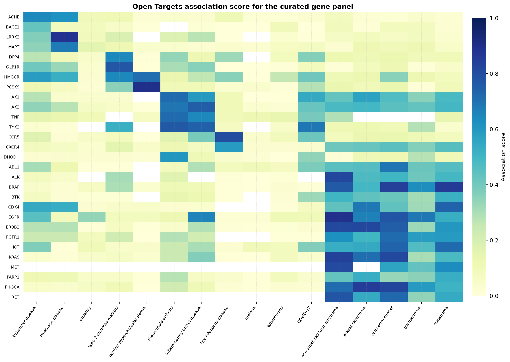
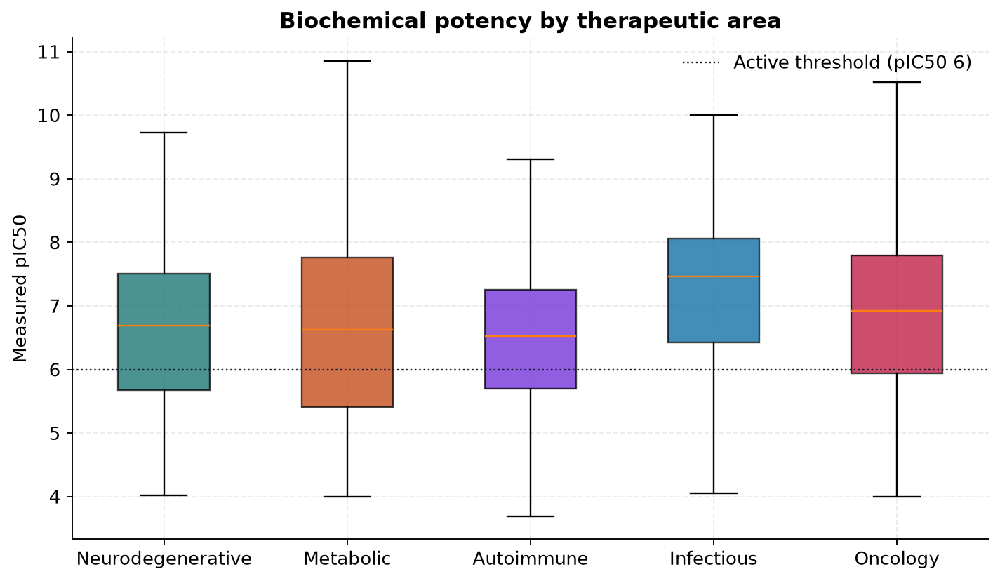
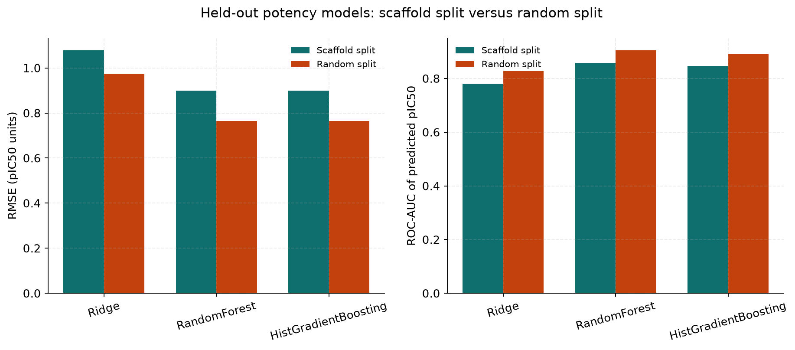
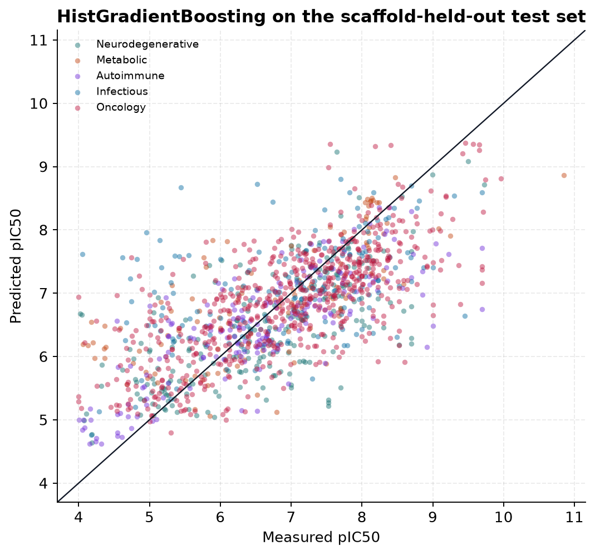
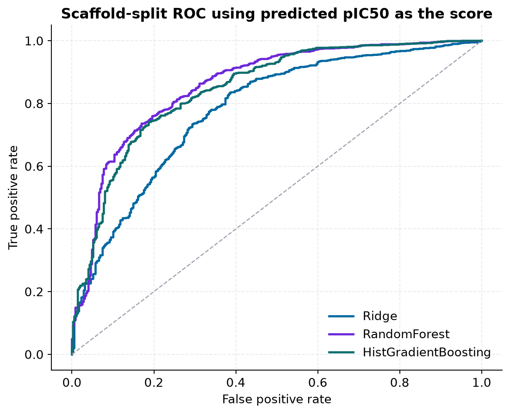
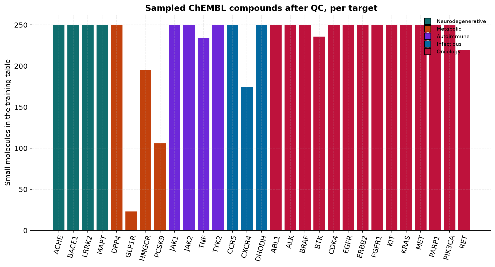
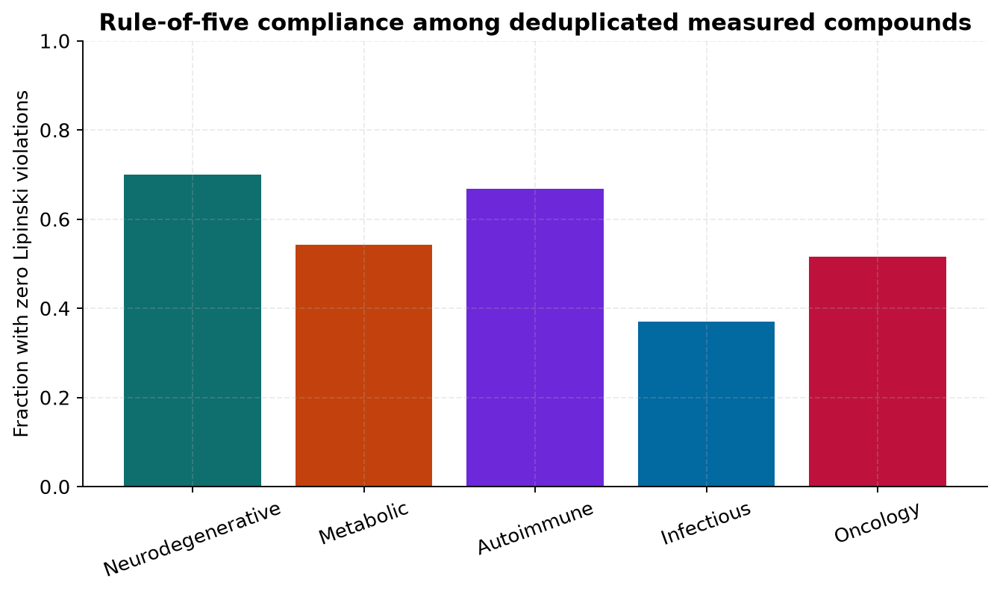
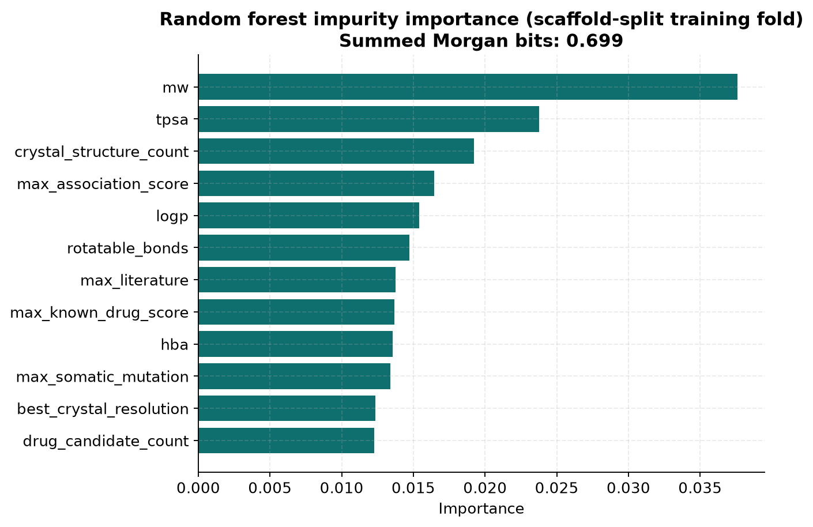
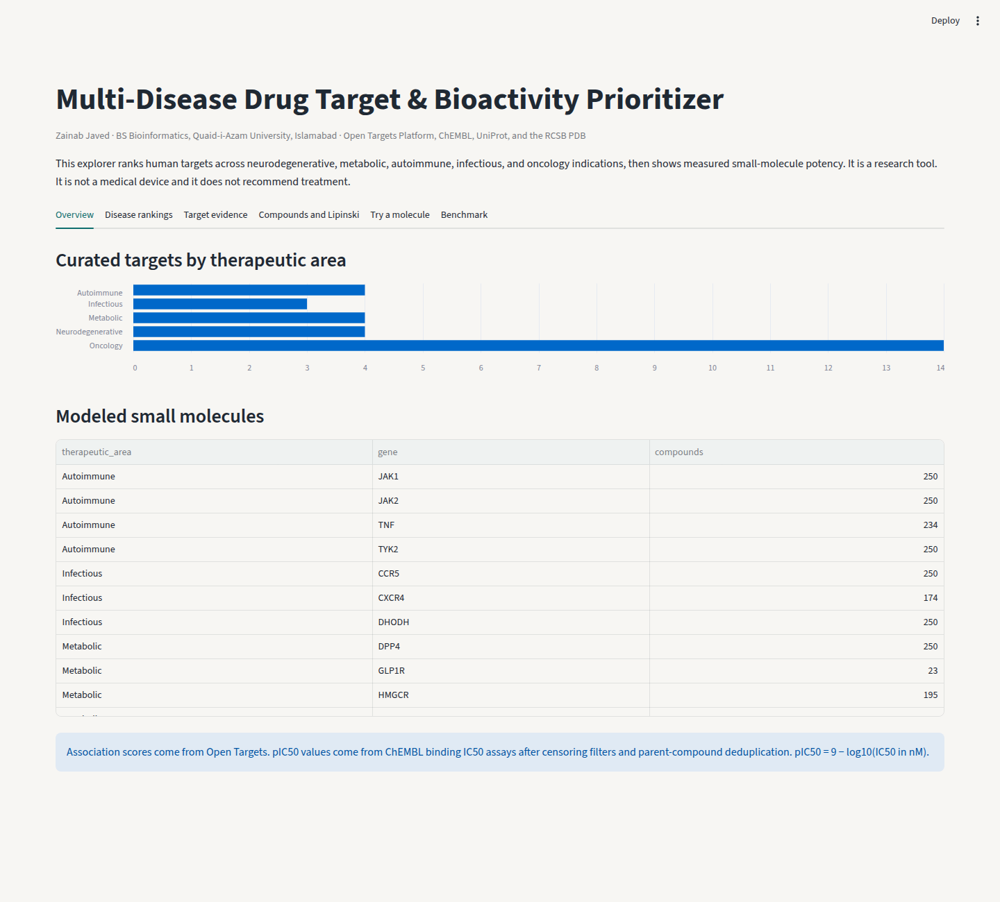

# Multi-Disease Drug Target & Bioactivity Prioritizer

[](https://www.python.org/)
[](https://github.com/zainab-123-spec/oncogene-drug-target-prioritizer/actions/workflows/tests.yml)
[](https://docs.astral.sh/ruff/)
[](LICENSE)

**Repository:** [github.com/zainab-123-spec/oncogene-drug-target-prioritizer](https://github.com/zainab-123-spec/oncogene-drug-target-prioritizer)

An end-to-end Python pipeline, command-line interface, and Streamlit app that asks a practical drug-discovery question across **neurology, metabolism, immunology, infection, and cancer**:

1. Which human proteins does public genetic and clinical evidence connect to a disease?
2. How potent are known small molecules against those proteins, on a comparable pIC50 scale?
3. Can a model predict that potency for a new structure **without** being rewarded for memorizing near-duplicate analogs?

The package lives in `odtp/`. Oncology is one therapeutic area in the panel, not the whole project.

**Author:** Zainab Javed, BS Bioinformatics, Quaid-i-Azam University, Islamabad.
GitHub: [`zainab-123-spec`](https://github.com/zainab-123-spec)

This is a research and learning project. It is not a medical device and it does not recommend treatment.

## What you can do with it

- Rank Open Targets genes for Alzheimer disease, Parkinson disease, epilepsy, type 2 diabetes, familial hypercholesterolemia, rheumatoid arthritis, inflammatory bowel disease, HIV infection, malaria, tuberculosis, COVID-19, and five cancers.
- Inspect tractability (approved small-molecule drug, high-quality pocket), safety-liability counts, UniProt domains, and PDB crystal resolution.
- Browse deduplicated ChEMBL binding IC50s, Lipinski profiles, and Bemis-Murcko scaffolds for targets such as LRRK2, BACE1, ACHE, GLP1R, DPP4, PCSK9, HMGCR, JAK1, JAK2, TNF, TYK2, CCR5, EGFR, BRAF, and KRAS.
- Train Ridge, Random Forest, and HistGradientBoosting models and compare a **scaffold split** with a **random split**.
- Try a SMILES string in the Streamlit app.

## Snapshot

Figures below are written by `python -m odtp all` from the live APIs. The numbers in the benchmark section are copied from that run's `data/processed/metrics.json`. They are not hand-entered targets.

<!-- BENCHMARK:START -->
Live run on 26 October 2026. Python 3.12, scikit-learn 1.9.1, RDKit 2026.09.1. Full table: `docs/reports/benchmarks.md` and `data/processed/metrics.json`.

ChEMBL reports **228,236** binding IC50 rows for these 29 proteins. The pipeline fetched **16,480** (three archive windows), kept **11,197** exact molar measurements, **9,722** parent-compound pairs, **9,090** small molecules (MW 150–700), and **6,688** rows after the 250-compound cap. GLP1R is the thin case: 238 reported binding IC50s, **23** small molecules in the model. PCSK9 contributed 106. Most kinases hit the cap.

Held-out scaffold split: 5,360 train / 1,328 test, **0 shared scaffolds**, test active rate 0.739. Random split: 5,350 / 1,338, **525 shared scaffolds**, active rate 0.740.

### Regression (predict pIC50)

| Model | Split | RMSE | Pearson r | Spearman rho | ROC-AUC | PR-AUC |
| --- | --- | ---: | ---: | ---: | ---: | ---: |
| MeanBaseline | scaffold | 1.242 | — | — | — | — |
| MeanBaseline | random | 1.237 | — | — | — | — |
| Ridge | scaffold | 1.079 | 0.536 | 0.541 | 0.780 | 0.896 |
| Ridge | random | 0.972 | 0.628 | 0.634 | 0.827 | 0.922 |
| RandomForest | scaffold | 0.900 | 0.705 | 0.708 | 0.859 | 0.933 |
| RandomForest | random | 0.764 | 0.799 | 0.804 | 0.905 | 0.963 |
| HistGradientBoosting | scaffold | 0.900 | 0.690 | 0.686 | 0.846 | 0.929 |
| HistGradientBoosting | random | 0.764 | 0.786 | 0.788 | 0.892 | 0.957 |

### Classification (active if pIC50 ≥ 6)

| Model | Split | ROC-AUC | PR-AUC |
| --- | --- | ---: | ---: |
| PrevalenceBaseline | scaffold | 0.500 | 0.739 |
| PrevalenceBaseline | random | 0.500 | 0.740 |
| RidgeClassifier | scaffold | 0.794 | 0.902 |
| RidgeClassifier | random | 0.825 | 0.919 |
| RandomForest | scaffold | 0.872 | 0.948 |
| RandomForest | random | 0.902 | 0.957 |
| HistGradientBoosting | scaffold | 0.864 | 0.942 |
| HistGradientBoosting | random | 0.900 | 0.957 |

Random forest and gradient boosting tie on scaffold-split RMSE (**0.900** versus a mean baseline of **1.242**). The random split is optimistic: RMSE gap about **0.14** and ROC-AUC gap about **0.05** for those two models. About three quarters of the test compounds are active, so PR-AUC starts at **0.739** for a model that only knows the base rate. The forest's scaffold-split PR-AUC is **0.948**.

A few association scores from the same run, all with known-drug evidence taken from the Platform's `clinical` datatype when that was the id returned: PCSK9–familial hypercholesterolemia 0.893 (genetic 0.919, clinical 0.975); EGFR–NSCLC 0.888 (genetic 0.934, somatic 0.931, clinical 0.996); CCR5–HIV 0.795 (clinical 0.980); LRRK2–Parkinson disease 0.879 (genetic 0.927, no clinical/known-drug score returned); GLP1R–type 2 diabetes 0.769; BACE1–Alzheimer disease 0.422.
<!-- BENCHMARK:END -->



















## Why these diseases

A target-prioritization tool that only knows oncology will look clever on EGFR and lost on everything else a drug-discovery team actually works on. The panel is grouped for display, but every gene is scored against every disease, so cross-area evidence stays visible. JAK2 is filed under autoimmune even though it also matters in blood cancers. The heatmap is allowed to say so.

| Area | Diseases | Example targets |
| --- | --- | --- |
| Neurodegenerative | Alzheimer disease, Parkinson disease, epilepsy | LRRK2, BACE1, MAPT, ACHE |
| Metabolic | Type 2 diabetes, familial hypercholesterolemia | GLP1R, DPP4, PCSK9, HMGCR |
| Autoimmune | Rheumatoid arthritis, inflammatory bowel disease | JAK1, JAK2, TNF, TYK2 |
| Infectious (host proteins) | HIV, malaria, tuberculosis, COVID-19 | CCR5, CXCR4, DHODH |
| Oncology | NSCLC, breast carcinoma, colorectal cancer, glioblastoma, melanoma | EGFR, BRAF, ERBB2, ALK, MET, PIK3CA, KRAS, CDK4, PARP1, ABL1, KIT, RET, FGFR1, BTK |

Familial hypercholesterolemia (`MONDO_0005439`) is the Open Targets disease used for the hypercholesterolemia indication. It is the inherited high-cholesterol disease most directly tied to PCSK9 and HMGCR. CCR5 and CXCR4 are human HIV entry co-receptors. DHODH is the human nucleotide-synthesis enzyme, not the parasite enzyme.

Two stories are worth holding at the same time. PCSK9 loss-of-function genetics plus approved medicines is a success of target selection. BACE1 had strong Alzheimer genetics and many potent inhibitors, and those inhibitors still failed in patients. A low predicted IC50 is not clinical efficacy.

## Data sources

| Source | What it contributes | Endpoint |
| --- | --- | --- |
| Open Targets Platform GraphQL | Disease-gene association scores, datatype scores, small-molecule tractability, safety events, clinical-candidate count | `https://api.platform.opentargets.org/api/v4/graphql` |
| ChEMBL REST | Human binding IC50s (`assay_type=B`), relations, units, canonical SMILES, parent compound ids | `https://www.ebi.ac.uk/chembl/api/data/` |
| UniProt REST | Sequence length, domain count, protein name | `https://rest.uniprot.org/uniprotkb/{accession}.json` |
| RCSB Search + Data API | X-ray structure count, best crystal resolution, ligand-bound crystal count | `https://search.rcsb.org/rcsbsearch/v2/query` and `https://data.rcsb.org/graphql` |

The current Platform release reports clinical / known-drug evidence as the datatype id `clinical`. Older releases used `known_drug`. The pipeline stores `known_drug_score` from `known_drug` when that id exists, and otherwise from `clinical`, and it keeps a `known_drug_source` column so the rename is explicit.

Ki is not mixed into the label. Functional cell assays (`assay_type=F`) are not mixed in either. The label is biochemical binding pIC50:

```text
pIC50 = 9 - log10(IC50 in nM) = -log10(IC50 in molar)
```

An active compound in the classifier is one with pIC50 ≥ 6, which is an IC50 of 1 µM or lower.

## How a row is allowed into the model

1. Relation must be `=`. Rows with `>`, `<`, `>=`, or `<=` are dropped. A censored measurement is not a number.
2. Units must be molar (`nM`, `µM`, `mM`, `M`, including common ChEMBL spellings) and are converted to nM.
3. Rows with a ChEMBL data-validity comment or `potential_duplicate = 1` are dropped. Non-human targets are dropped.
4. Duplicate parent-compound / target pairs collapse to the **median** pIC50.
5. RDKit must parse the SMILES. Descriptors and a Morgan fingerprint (radius 2, 512 bits) are computed.
6. The modeled set keeps organic molecules with molecular weight between 150 and 700. Peptides and tiny fragments stay in `activities_dedup.csv` so the Lipinski view can show them, but they do not train the model.
7. Each gene is capped at 250 compounds after that filter (`seed=42`). ChEMBL pages are sampled from the beginning, middle, and end of large assay archives (`page_size=200`, 3 windows) so the cap is not "the oldest 250 assays."

`data/processed/qc_funnel.csv` records, per gene, how many binding IC50s ChEMBL reports, how many were fetched, and how many survived each filter. That file is the honest denominator.

## Models and the split

Features for each compound-target pair:

- Molecule: molecular weight, LogP, hydrogen-bond donors and acceptors, rotatable bonds, TPSA, aromatic rings, Lipinski violation count, Morgan bits.
- Target: max Open Targets association, genetic, somatic, known-drug/clinical, and literature scores on this disease panel; count of panel diseases with score ≥ 0.2; safety-event count; approved-drug, high-quality-pocket, and ligand-bound-structure flags; clinical-candidate count; sequence length; domain count; best crystal resolution; crystal count; ligand-bound crystal count; a one-hot of the primary therapeutic area.

There is no one-hot of the gene symbol. The model has to use chemistry and these biology features, not a memorized per-gene average. Missing numeric values are filled with the **training-fold** median. Ridge is standardized with a scaler fit on the training fold only.

| Model | Task |
| --- | --- |
| Mean baseline / prevalence baseline | Reference |
| Ridge / Ridge classifier | Linear |
| Random forest (200 trees, `random_state=42`, one job for determinism) | Nonlinear |
| HistGradientBoosting (200 iterations, early stopping off) | Nonlinear |

For regressors, ROC-AUC and PR-AUC use the predicted pIC50 as the ranking score against the active label. Classifiers do not get an RMSE, because that number would be made up.

**Scaffold split.** Molecules are grouped by Bemis-Murcko scaffold. `GroupShuffleSplit` holds out 20% of scaffolds. A ringless molecule gets its own `ACYCLIC::<smiles>` group so every chain is not dumped into one empty scaffold. Shared scaffolds between train and test must be zero.

**Random split.** Same 20% of rows, same seed. Shared scaffolds are counted. The leakage gaps are:

```text
RMSE gap = scaffold RMSE - random RMSE
AUC gap  = random AUC - scaffold AUC
```

A positive gap means the random split was optimistic: near-analogs leaked across the cut.

The demo model saved at `data/models/demo_hgb.joblib` is refit on all modeled rows **after** the held-out metrics are written. The tables do not come from that demo model. The Streamlit page says this in the prediction tab.

## Run it

```bash
python -m pip install -e ".[dev]"
python -m odtp all          # download, train, write figures and a few gene reports
python -m odtp analyze EGFR
streamlit run app.py
ruff check . && ruff format --check .
pytest
```

Useful pieces:

```bash
python -m odtp build       # APIs + QC only
python -m odtp train       # models, docs/figures, docs/reports/benchmarks.md
python -m odtp analyze PCSK9
```

The first `all` run talks to four public APIs and respects a short pause between calls. Responses are cached under `data/cache/` (gitignored) so a rerun does not repeat successful calls. Processed tables, figures, and metrics are the artifacts meant to be read.

Gene reports land in `docs/reports/` (EGFR, PCSK9, BACE1, CCR5, JAK1, ACHE, DPP4 from `odtp all`).

## Repository map

```text
odtp/config.py            disease and target panel, feature names
odtp/http.py              cache, pause, retries
odtp/clients/             Open Targets, ChEMBL, UniProt, RCSB
odtp/qc.py                units, censoring, median dedup
odtp/features.py          RDKit descriptors, scaffolds, fingerprints
odtp/model.py             splits, metrics, leakage gaps, demo model
odtp/plotting.py          figures
odtp/reports.py           markdown and HTML rendered from metric dicts
odtp/pipeline.py          build, train, analyze
odtp/cli.py               python -m odtp
app.py                    Streamlit explorer
tests/                    mocked API fixtures, no live network
```

`LEARNING_GUIDE.md` explains the biology, the chemistry, why the scaffold split exists, and 15 interview questions.

## Tests and CI

GitHub Actions runs Ruff and pytest on Python 3.10 and 3.12 (`.github/workflows/tests.yml`). Tests use fake HTTP sessions and fake API clients. They check the pIC50 formula, censored-value filters, parent-compound deduplication, Murcko scaffolds, zero scaffold overlap, and that report text prints the numbers you hand it. They do not pretend a fixture RMSE is a ChEMBL result.

## Limits, on purpose

- Binding IC50s from many labs, even after QC, are not one assay protocol.
- Publication bias loads ChEMBL toward active compounds.
- The 250-compound cap and the three archive windows are a sample, not the full ChEMBL matrix. `qc_funnel.csv` shows the gap.
- Ligand-bound counts are PDB non-polymer entities in the best-resolution crystals we inspected. They are not a pocket-detection program. The pocket flag comes from Open Targets tractability.
- The model predicts biochemical potency for proteins in this panel. It does not predict safety, selectivity, exposure, or whether a patient benefits.
- Association evidence and a potent IC50 can still fail in the clinic. BACE1 is the reminder in this panel.

## License

MIT. Copyright 2026 Zainab Javed. See [LICENSE](LICENSE).
